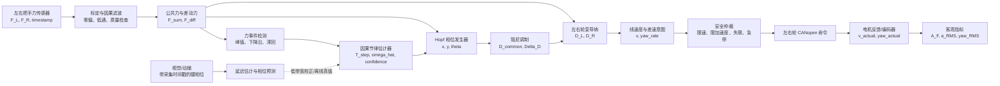
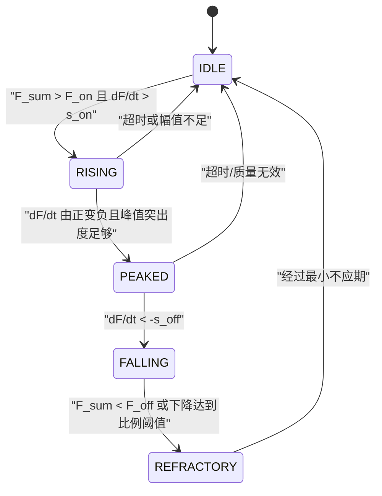
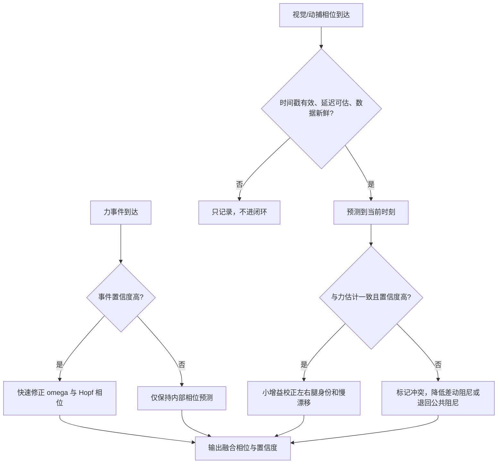
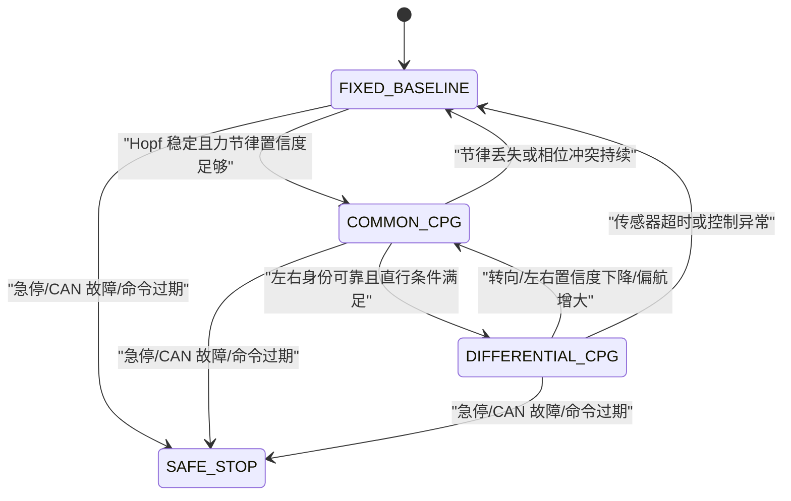

# 基于交互力耦合 Hopf-CPG 的双轮变导纳控制研究方案

> 2026-10-17 状态更新：本文保留为历史/备选路线，当前讨论以[个性化基准阻尼与步态相位减阻基线](GAIT_PHASE_PBO_ADMITTANCE_BASELINE.md)为准。力主导估相位、动捕仅作辅助、左右差动阻尼和排除主观偏好的提议不再默认约束当前方向；本次明确固定 M、试次间 PBO、动捕直接/Hopf 并列及局部减阻窗口。正文保留以追溯演变，其中“稳定极限环”不能解释为已与人体锁相，“动捕真值”仍需估计与延迟/质量验证。时间戳、实际反馈、速度混杂控制、异常降级和统一安全出口等要求继续适用；V1 非人体测试边界不变。

> 文档性质：研究设计与后续实现建议，不代表当前固件已编译、烧录或实机验证。  
> 当前仓库状态：Phase 1 部分完成；现有 `MDK-ARM/` 与 `Core/` 代码仅作为参考实现取证。  
> 名词说明：正确名称为 **Hopf 振荡器**，不是 Holf 振荡器。

## 1. 会议问题的结论

本研究应收敛为以下主线：

> 人与助行车之间的纵向交互力包含步行节律。利用因果的力信号相位估计器校正 Hopf 振荡器，使其产生连续、可预测的左右交替相位；再由该相位调制公共纵向阻尼与受限的左右差动阻尼。最终通过交互力振荡幅值和实际车体加速度降低，并在平均速度、轨迹偏差和安全性不恶化的约束下，证明控制策略有效。

对三个争议点的建议如下：

| 问题 | 建议结论 | 原因 |
|---|---|---|
| 为什么引入 CPG，为什么选择 Hopf | 引入 CPG 是为了把有噪声、间断的步态事件变成连续相位；选择 Hopf 是因为它具有稳定极限环、连续相位、幅频参数相对解耦，并可被周期交互力同步 | 固定导纳只有固定参数，不能表达步行周期内不同阶段对“助力/稳定”的不同需求 |
| 左右轮阻尼是否不同 | 可以研究不同，但不能直接把“右腿支撑”机械等同为“右轮一定大阻尼”；应将支撑侧高阻尼和支撑侧低阻尼都作为待验证极性，并设置直行、偏航与差动幅度约束 | 差动阻尼会产生左右轮速度差和偏航；哪种极性更优必须由交互力、加速度和轨迹数据决定 |
| 视觉和动捕是否摒弃 | 不摒弃，但改变角色：力传感器负责实时闭环；视觉/动捕负责离线真值、左右腿身份初始化和低带宽相位校正。若进入在线闭环，必须使用采集时间戳和延迟预测 | 延迟观测并非天然违反因果，只要只使用当前及过去信息，并把旧相位预测到控制时刻；但它不适合单独承担快速闭环 |

## 2. 为什么固定导纳不足

固定导纳可写为：

\[
M\dot v + Dv = F_h
\]

其中，`F_h` 是人对车的纵向交互力，`M` 是虚拟质量，`D` 是虚拟阻尼，`v` 是期望车速。

固定参数的矛盾是：

- 较小阻尼使车更容易被推动，但也更容易因瞬时推力产生速度突变；
- 较大阻尼使车更稳定，却要求人持续施加更大的交互力；
- 人的步行和推车动作具有周期性，同一周期内“推进”和“换腿/恢复”阶段需要的响应并不相同；
- 一个固定 `D` 只能在轻便性和稳定性之间取静态折中，不能随步态相位变化。

因此研究目标不是“让 CPG 直接生成轮速”，而是让 CPG 提供相位变量 `theta`，据此在线改变导纳参数。

## 3. 为什么选择 Hopf 振荡器

参考实现使用：

\[
\dot x=\alpha(\mu-x^2-y^2)x-\omega y+\epsilon F_h
\]

\[
\dot y=\alpha(\mu-x^2-y^2)y+\omega x
\]

定义：

\[
r=\sqrt{x^2+y^2},\qquad \theta=\operatorname{atan2}(y,x)
\]

在无外部耦合的理想情况下：

\[
\dot r=\alpha(\mu-r^2)r,\qquad \dot\theta=\omega
\]

这带来四个适合本课题的性质：

1. **稳定极限环**：状态偏离后会回到 `r = sqrt(mu)`，不会像纯积分相位那样任意漂移。
2. **连续相位**：即使一次力峰检测丢失，振荡器仍可根据内部状态继续预测相位。
3. **参数可解释**：`mu` 控制极限环幅值，`omega` 控制节律，`alpha` 控制恢复速度。
4. **可同步性**：周期交互力可以用于相位校正，使内部节律逐渐锁定到人的推行节律。

但必须注意：当前参考代码只把 `epsilon * F_ext` 加到 `x` 方程，并通过 `CPG_Update_Frequency()` 接收外部频率。它**不是完整的在线频率自适应器**。如果研究目标改为“仅依靠交互力跟踪步态”，需要增加独立的事件/相位估计模块，不能仅宣称现有耦合项已经完成频率识别。

## 4. 推荐的整体控制结构



控制链的职责应明确分离：

- 力传感器提供快速、直接的人车交互信息；
- 节律估计器输出 `omega_hat`、相位事件和置信度；
- Hopf 输出连续相位，不直接写电机；
- 阻尼映射只计算参数；
- 安全仲裁是唯一电机命令出口；
- 视觉/动捕不能绕过安全层，也不直接覆盖当前控制状态。

## 5. 用力传感器实时估计换腿节律

### 5.1 当前工作区可以利用的基础

参考协议每帧解析六个浮点数，实际得到两组 `XYZ` 力，即 `force1` 和 `force2`。但当前任务只把 `f1` 投递给控制队列，`f2` 被注释掉；控制器也只使用 `force->fx`。因此：

- 协议层看起来已经预留两组力数据；
- 这两组是否对应左右把手，必须通过接线、传感器手册和逐侧加载实验确认；
- 未确认前不能把 `f1` 定义成左手或右手，更不能据此判断左右腿；
- 如果确认为左右把手，应同时保留 `F_xL`、`F_xR`，而不是只保留一组。

建议定义：

\[
F_{sum}=F_{xL}+F_{xR}
\]

\[
F_{diff}=F_{xR}-F_{xL}
\]

`F_sum` 主要表示纵向推进交互，适合检测周期；`F_diff` 可能包含身体侧向转移、手部不对称和转向意图，只能经过标定后作为左右相位的辅助证据。

### 5.2 因果信号处理

控制器只能使用当前和过去样本。推荐管线：

1. 对每侧力做零偏扣除和方向统一；
2. 使用因果低通滤波器抑制手抖和电噪声，初始候选截止频率可设为 3–5 Hz，但必须根据实测频谱冻结；
3. 计算 `F_sum` 的一阶差分 `dF/dt`；
4. 使用带滞回的状态机检测“施力开始、峰值、下降结束”事件；
5. 用最近若干有效事件间隔估计节律，并输出置信度；
6. 用事件修正 Hopf 相位，在事件之间由 Hopf 连续预测。

不建议仅用“`F_x` 比上一点小”作为换腿条件。噪声会造成大量误触发，而且一次下降不能区分正常峰后下降、握力调整、刹车或转弯。至少需要幅值阈值、下降斜率、峰值突出度、不应期和滞回。

### 5.3 事件检测状态机



建议每次有效下降事件输出：

```text
event_time        事件对应的传感器采集时间
event_type        PUSH_END / PEAK / UNKNOWN
period_estimate   最近事件间隔的稳健估计
phase_anchor      该事件在 Hopf 周期中对应的目标相位
confidence        0~1，综合幅值、突出度、周期一致性和数据新鲜度
```

### 5.4 频率与相位如何更新

设相邻换腿事件间隔为 `T_step`。如果每个事件对应一次左右腿交换，则一次事件是 Hopf 的半周期：

\[
\hat\omega_{meas}=\frac{\pi}{T_{step}}
\]

如果实验表明 `F_sum` 每个完整步态周期只出现一个可靠事件，则应改用：

\[
\hat\omega_{meas}=\frac{2\pi}{T_{cycle}}
\]

不能仅凭理论决定采用哪一个，必须用同步视频/动捕离线标注一次，确认“力事件和左右脚事件是一对一还是二对一”。

为避免单次误检使频率突变，可采用有界指数更新：

\[
\hat\omega_k=\operatorname{clamp}\left((1-\beta)\hat\omega_{k-1}+\beta\hat\omega_{meas},\ \omega_{min},\ \omega_{max}\right)
\]

同时进行相位校正：

\[
e_\theta=\operatorname{wrap}(\theta_{anchor}-\theta^-)
\]

\[
\theta^+=\theta^-+K_\theta\,c\,e_\theta
\]

其中 `c` 是事件置信度。置信度低时只预测，不强行拉相位；连续多个事件丢失时冻结频率并逐渐退回固定导纳。

这一方法是因果的：事件出现后修正当前和未来状态，不尝试修改已经执行过的控制命令。

## 6. 视觉/动捕的时间顺序问题如何解决

### 6.1 延迟不等于非因果

视觉在采集、传输和识别后得到的是过去时刻 `t_m` 的腿部相位 `theta_m`。若系统保存采集时间戳，并估计总延迟，则可将它预测到当前控制时刻 `t_c`：

\[
\theta_{vis,pred}(t_c)=\operatorname{wrap}\left(\theta_m+\hat\omega(t_c-t_m)\right)
\]

这没有使用未来信息，只是把过去观测按当前频率向前传播。真正的问题是预测误差会随延迟和步频突变增大，因此视觉不宜成为唯一快速反馈。

### 6.2 推荐的角色分工

| 数据源 | 在线角色 | 离线角色 |
|---|---|---|
| `F_sum` | 快速节律事件、相位校正、推行意图 | 计算交互力幅值和 RMS |
| `F_diff` | 左右身份辅助、转向/不对称检测 | 分析身体侧向负荷和手部不对称 |
| 视觉腿部关键点 | 低带宽左右腿身份校正；仅在时间戳、延迟、置信度有效时使用 | 标注支撑腿、摆动腿和力事件对应关系 |
| 动作捕捉 | 原型阶段可作低带宽相位校正，不建议作为唯一实时控制源 | 作为腿相位、车速、加速度和轨迹的真值 |
| 当前 ArUco 位姿帧 | 当前参考代码只有标记位姿/距离，不能直接给出左右腿相位 | 可验证车体位移和视觉链路；若要识别腿相位需新增上位机算法和协议字段 |

### 6.3 推荐融合逻辑



因此不需要在“完全使用视觉”和“完全删除视觉”之间二选一。推荐架构是：**力闭环为主，视觉/动捕作为有时间戳的辅助观察器和实验真值。**

## 7. 左右轮阻尼如何设计

### 7.1 先区分公共阻尼和差动阻尼

不要直接独立地随意设置两个阻尼。先定义：

\[
D_L=D_c-\Delta D
\]

\[
D_R=D_c+\Delta D
\]

其中：

- `D_c` 是公共纵向阻尼，决定整车总体“轻/重”；
- `Delta_D` 是差动阻尼，决定左右响应差异；
- 两侧平均阻尼始终为 `D_c`，便于把纵向助力效应和偏航效应分开分析。

公共阻尼可由 Hopf 的偶对称量调制，例如：

\[
D_c=\operatorname{clamp}(D_0-k_c q_c(\theta),D_{min},D_{max})
\]

差动阻尼可由左右相位符号调制：

\[
\Delta D=\operatorname{sat}_{[-\Delta D_{max},\Delta D_{max}]}
\left(k_d\,c_{side}\,q_d(\theta)\right)
\]

最简单的候选是 `q_d(theta) = sin(theta)`，左右相差 180°。`c_side` 是左右腿身份置信度；不能可靠判断左右腿时，令 `c_side = 0`，只保留公共阻尼。

### 7.2 哪一侧阻尼大不能先验定死

老师提出“支撑腿侧阻尼大、摆动腿侧阻尼小”是一个合理候选假设：支撑侧高阻尼可能增强稳定感，摆动侧低阻尼可能有利于前进。但在轮式助行器上，腿和轮之间没有刚性一一映射，反向极性也可能更能降低交互力。

因此应设计三个客观对照：

| 模式 | 支撑腿侧 | 摆动腿侧 | 目的 |
|---|---:|---:|---|
| `P0` 公共变阻尼 | `D_c` | `D_c` | 判断仅用周期公共阻尼是否已经有效 |
| `P+` 支撑侧高阻尼 | `D_c + Delta_D` | `D_c - Delta_D` | 验证老师提出的稳定性假设 |
| `P-` 支撑侧低阻尼 | `D_c - Delta_D` | `D_c + Delta_D` | 验证相反极性是否更省力或更平顺 |

最终选择依据必须是交互力幅值、实际加速度、偏航和轨迹偏差，而不是主观感受。

### 7.3 差动阻尼的安全门控

差动阻尼会引起转向，必须满足：

\[
|\Delta D|\leq \Delta D_{max}
\]

并只在以下条件同时满足时启用：

- 识别为直行任务；
- 左右腿身份置信度高于阈值；
- 力数据新鲜且没有制动/反向推拉；
- 实际偏航率和左右轮速差未超过限制；
- 安全仲裁允许变导纳模式。

如果检测到转向意图、相位冲突、传感器超时或偏航过大，应令 `Delta_D -> 0`，平滑退回公共阻尼或固定导纳。不能瞬间切换，以免产生轮速阶跃。

## 8. 推荐控制状态机



该状态机保证：CPG 失效不会直接导致电机失控，系统可以逐级退回公共阻尼、固定导纳和安全停车。

## 9. 如何用纯客观指标证明理论有效

### 9.1 主要效果指标一：交互力振荡幅值

先对 `F_sum` 做零偏校正和离线低频趋势分离，得到周期分量 `F_tilde`。对每个有效步态周期 `k`，使用稳健峰谷幅值：

\[
A_{F,k}=\frac{P_{95}(\tilde F_k)-P_{5}(\tilde F_k)}{2}
\]

再计算所有周期的中位数或均值：

\[
\bar A_F=\operatorname{median}(A_{F,1},\ldots,A_{F,K})
\]

采用分位数而不是单点最大最小值，可降低尖峰噪声影响。核心效果量为：

\[
R_F=\frac{\bar A_{F,fixed}-\bar A_{F,cpg}}{\bar A_{F,fixed}}\times100\%
\]

`R_F > 0` 表示 CPG 变导纳降低了周期性交互力幅值。

同时报告：

\[
F_{RMS}=\sqrt{\frac{1}{N}\sum_{i=1}^{N}F_{sum,i}^2}
\]

`A_F` 反映周期波动；`F_RMS` 反映总体交互力水平。两者不能互相替代。

### 9.2 主要效果指标二：实际车体加速度

不能只对 `v_cmd` 求导来证明车体加速度降低，因为 `v_cmd` 是算法命令，不是车辆真实运动。必须优先使用左右轮编码器反馈或外部动捕/高质量里程计得到实际速度：

\[
v_{actual}=\frac{R}{2}(\omega_L+\omega_R)
\]

电机安装符号应先转换为统一的物理前进正方向。对滤波后的实际速度求导：

\[
a_i=\frac{v_{i+1}-v_{i-1}}{2\Delta t}
\]

然后计算：

\[
a_{RMS}=\sqrt{\frac{1}{N}\sum_{i=1}^{N}a_i^2}
\]

和稳健峰值：

\[
a_{95}=P_{95}(|a|)
\]

核心效果量为：

\[
R_a=\frac{a_{RMS,fixed}-a_{RMS,cpg}}{a_{RMS,fixed}}\times100\%
\]

`R_a > 0` 表示实际速度变化减缓。

### 9.3 必须同时满足的公平性和安全约束

如果 CPG 只是让车整体变慢，交互力幅值和加速度可能自然下降，但这不能证明控制更好。因此主要指标必须在以下约束下比较：

| 约束指标 | 目的 |
|---|---|
| 平均实际速度或完成时间匹配 | 排除“单纯降速”造成的虚假改善 |
| 路径横向偏差、偏航率 RMS 不增加 | 防止左右差动阻尼以牺牲直行稳定性换取指标下降 |
| 限幅、急停、传感器超时次数不增加 | 保证改善不是依赖频繁触发保护 |
| 相同载荷、路面、初始条件和输入回放 | 保证 A/B 对照公平 |
| 固定导纳随时可回退 | 满足仓库既定安全与可比较性要求 |

推荐把论文成功条件写成联合判据，而不是单指标：

\[
\bar A_{F,cpg}<\bar A_{F,fixed}
\]

\[
a_{RMS,cpg}<a_{RMS,fixed}
\]

同时：

\[
|\bar v_{cpg}-\bar v_{fixed}|/\bar v_{fixed}\leq \delta_v
\]

且偏航/轨迹与安全指标不恶化。`delta_v` 不能先猜，应由实验方案和老师共同冻结。

### 9.4 机制指标

为了证明“改善来自 Hopf-CPG，而不是偶然调参”，还应记录：

- 极限环半径误差 `e_r = |sqrt(x^2+y^2) - sqrt(mu)|`；
- 力事件频率与 Hopf 频率误差；
- 力事件到 Hopf 相位锚点的相位误差；
- `D_c`、`D_L`、`D_R` 的调制波形；
- CPG 模式占比、置信度和退化次数；
- 左右轮实际速度差与偏航率。

这些指标证明算法链条确实按设计工作，但不能替代 `A_F` 和 `a_RMS` 两个效果指标。

## 10. 推荐实验矩阵

当前 V1 明确不包含人体测试。以下顺序先做非载人验证；人体实验只能在后续伦理、安全和项目范围明确后进行。

### E0：离线信号可观测性

目标：先确认交互力里是否真的有稳定的换腿信息。

1. 在不驱动电机或外部记录条件下采集左右力与同步视频/动捕真值；
2. 标注左右脚触地、离地和力峰/下降事件；
3. 计算事件一对一或二对一关系、检测延迟、漏检率、误检率；
4. 判断 `F_sum` 能否提供周期，`F_diff` 能否提供左右身份；
5. 若左右身份不可辨，只进入公共变阻尼，不启用差动阻尼。

### E1：记录回放 A/B

对同一组历史力数据离线运行：

- `B0` 固定导纳；
- `B1` 公共 Hopf 变导纳；
- `B2` 支撑侧高阻尼；
- `B3` 支撑侧低阻尼；
- `B4` 视觉延迟补偿融合开/关。

比较输出有限性、相位稳定性、阻尼范围、速度命令、加速度命令和偏航意图。此阶段只说明算法行为，不能替代真实车辆加速度证据。

### E2：抬轮/受控台架

验证：

- 左右物理方向；
- 左右轮速度反馈；
- 差动阻尼极性；
- 模式切换瞬态；
- 传感器丢失时退回固定导纳；
- 偏航约束和加速度限制。

### E3：后续系统研究

只有在 V1 之外另行批准后，才设计人体或目标用户实验。采用受试者内随机交叉设计，只使用客观指标：`A_F`、`F_RMS`、`a_RMS`、`a95`、平均速度、完成时间、偏航率、轨迹偏差和故障/限幅次数，不采集主观 Likert 评分。

## 11. 对当前参考代码的差距分析

| 当前实现 | 与新研究目标的差距 | 后续模块建议 |
|---|---|---|
| `processForceData()` 已解析两组 XYZ | `ForceSensorTask` 只投递 `f1`，没有左右语义、标定、质量和 CRC 证据 | 建立带左右通道、时间戳、有效性和质量码的 `ForceSamplePair` |
| `Controller_Run()` 只读取单个 `force->fx` | 无 `F_sum/F_diff`、事件检测、相位置信度和左右阻尼 | 拆成力节律估计、Hopf、阻尼映射、双轮导纳四个纯 C 模块 |
| `CPG_Step()` 输出单个 `v_c` | 只能得到共同轮速，不能研究左右轮不同阻尼 | 变导纳模块输出 `v_L/v_R` 或线速度/角速度意图，再交给运动映射 |
| `D_current` 是局部变量 | 无法记录机制数据 | 增加 `HopfDebug/ControlDebug`，记录 x/y/r/theta/omega/D_L/D_R/confidence |
| `CPG_Update_Frequency()` 仅接收外部浮点频率 | 没有从力事件在线估计频率，也没有相位锚定 | 新增因果 `GaitPhaseEstimator`，Hopf 只消费估计结果 |
| 日志约 10 Hz | 不足以分析力事件、相位、加速度和 jerk | 控制环写有界遥测缓冲，日志 50–100 Hz；真实加速度源采样率另行验证 |
| 电机反馈未进入闭环 | 只能分析命令，不能证明实际加速度降低 | 接入左右轮实际速度和驱动器状态 |
| 当前 ArUco 帧只有标记位姿和距离 | 不包含左右腿相位和视觉采集时间戳 | 若保留视觉腿相位，扩展上位机输出 `capture_ts/phase/side/confidence` |
| 当前 `CPG_V_MIN = -0.5 m/s` | 是否允许倒车未确认 | 在安全需求冻结前不得用于载人控制；直行研究通常应采用非负前进速度约束 |

建议的纯 C 接口边界：

```c
typedef struct {
    float omega_rad_s;
    float phase_rad;
    float confidence;
    uint8_t side_valid;
    uint8_t support_side;
} GaitPhaseEstimate;

typedef struct {
    float damping_left_ns_m;
    float damping_right_ns_m;
    float common_damping_ns_m;
    float differential_damping_ns_m;
} DampingCommand;
```

这些结构只表达研究意图，具体字段必须在 Phase 3 数据契约阶段冻结，并通过主机测试后才能进入平台集成。

## 12. 分阶段实现路径

1. **先冻结事实**：确认两组力数据是否对应左右把手，完成坐标、符号、零点、量程和采样率标定。
2. **建立固定导纳基线**：完成参考仓库既定 Phase 7，得到可回放、可切换的对照组。
3. **验证 Hopf 本体**：完成极限环、幅频、步长、长稳和异常输入测试。
4. **只做公共变阻尼**：先验证 `D_c(theta)`，避免左右差动同时引入偏航混杂因素。
5. **开发力节律估计器**：在记录数据上验证事件对应关系、频率误差和相位误差。
6. **加入低带宽视觉融合**：先离线做延迟估计和预测，不直接进入电机闭环。
7. **研究差动阻尼**：同时测试 `P0/P+/P-`，设置 `Delta_D` 限幅、置信度门控和偏航退化。
8. **接入实际轮速反馈**：没有实际速度就不能以 `a_RMS` 证明车体运动改善。
9. **完成非载人台架矩阵**：故障、切换、限幅、失联、偏航和长稳均有证据。
10. **另行审批系统实验**：只采用客观指标和随机交叉对照，不使用主观评分。

## 13. 当前最需要回答的实验问题

在开始修改控制代码前，应先用数据回答：

1. 两组力数据是否确实对应左右把手？它们的方向和单位是什么？
2. `F_sum` 的主要周期事件与每一步、每次换腿还是完整步态周期对应？
3. 单独使用 `F_sum` 能否稳定估计频率？`F_diff` 能否可靠识别支撑侧？
4. 力事件相对真实脚事件的平均延迟和抖动是多少？
5. 视觉腿相位的采集到控制延迟是否稳定，预测后误差是多少？
6. 支撑侧高阻尼 `P+` 和支撑侧低阻尼 `P-` 哪一个降低 `A_F` 与 `a_RMS`，同时不增大偏航？
7. 在平均速度匹配时，CPG 方案是否仍优于固定导纳？

其中第 1–4 项决定力闭环是否可行，第 5 项决定视觉能否作为辅助校正，第 6–7 项决定论文核心假设是否成立。

## 14. 最终建议

论文题目方向可表述为：

> **基于人车交互力耦合 Hopf 振荡器的双轮变导纳控制方法研究**

核心创新点不应写成“检测到 `F_x` 下降就换腿”，而应写成：

1. 构造基于双侧交互力的因果步态事件与相位估计；
2. 使用 Hopf 极限环在事件之间提供连续相位预测，并用力事件进行同步校正；
3. 将相位映射为公共阻尼和受偏航约束的差动阻尼；
4. 用视觉/动捕的时间戳预测解决延迟问题，并将其降级为辅助观察和实验真值；
5. 在平均速度与安全指标匹配的条件下，以交互力幅值 `A_F` 和实际加速度 `a_RMS` 的下降作为主要有效性证据。

这条路线既保留了视觉/动捕的研究价值，也把实时闭环建立在更直接的交互力上；同时没有预先假定“哪一侧阻尼一定更合理”，而是把阻尼极性变成可以通过客观实验回答的科学问题。

## 15. 工作区依据

- [产品需求](../../docs/product/PRODUCT_REQUIREMENTS.md)：固定导纳先行、Hopf CPG 独立接入、V1 不含人体试验。
- [系统架构](../../docs/construction/ARCHITECTURE.md)：控制域纯 C，所有电机输出经过安全仲裁。
- [施工计划](../../docs/construction/CONSTRUCTION_PLAN.md)：Phase 7 固定导纳、Phase 8 Hopf、Phase 9 集成、Phase 10 视觉与可观测性。
- [假设清单](../../docs/construction/ASSUMPTIONS.md)：力坐标、轮系参数、Hopf 参数和视觉角色仍待验证。
- [参考工程交接](../../docs/handover/PROJECT_HANDOVER.md)：当前力协议、CPG 参数、日志与未闭环功能的取证总结。
- `MDK-ARM/torque_sensor.c`：当前解析两组 XYZ 力数据。
- `MDK-ARM/cpg_control.c`：当前单 Hopf、单阻尼和单速度状态参考实现。
- `MDK-ARM/Controller.c`：当前仅使用一组 `F_x` 并输出共同轮速。
- `Core/Src/freertos.c`：当前力任务、1 ms 控制任务、10 Hz 日志、视觉解析和双轮速度发送参考实现。
