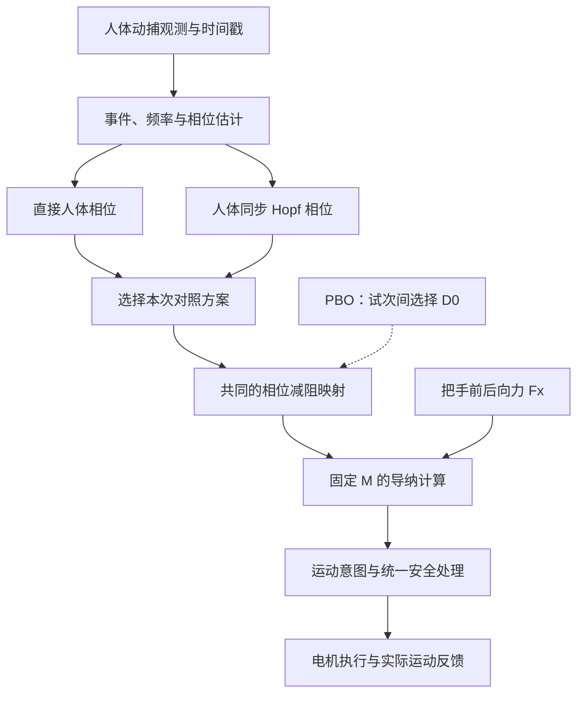

# SmartRollator 本地 Codex 交接提示词

> 用法：把本文件放入 SmartRollator 本地工作区，让 Codex 完整阅读，并执行第 12 节的首次接手任务。本文件已经包含研究讨论基线；即使没有之前的聊天记录，也可以接手。
>
> 交接日期：2026-10-17。目标仓库：https://github.com/NeilBaumanMax/SmartRollator 。
>
> 以下内容是我交给你的接手要求。文中的“我”指项目所有者；“你”指在我电脑上工作的 Codex。

## 1. 你要接手的任务与边界

你将持续协助我讨论、设计和实现 SmartRollator 智能助行车项目。请使用中文，先理解现有工程，再把下面的研究想法接入项目已有的文档、计划和代码工作流。

我希望解决的问题是：**让助行车的运动响应更符合使用者的习惯和行走节律，在容易推动、跟随自然、运动平稳和提供适当支撑之间取得合适的平衡。**

我们当前讨论的主线是：

**固定虚拟质量的导纳控制 → 个性化基准阻尼 → 按步态相位局部减阻 → 对比动捕直接相位与人体同步 Hopf 相位。**

请明确区分四种信息：

| 信息类别 | 应如何处理 |
|---|---|
| 用户已经确认的方向 | 作为后续讨论基线，不要反复重新询问 |
| 当前候选设计或研究假设 | 保留并安排验证，不能写成已证明的结论 |
| 代码实际实现的行为 | 以你当前本地代码和检查结果为准 |
| 历史方案、旧演示和旧研究笔记 | 保留来源与演变记录，不能自动覆盖本次交接的研究方向 |

本文件更新的是研究想法基线。它不表示新算法已经实现、整车已经验证，也不表示现有阶段门槛已经完成。首次接手请完成核对、差异分析和必要的文档对齐；**不要仅因为收到交接文件，就开始重写固件、烧录、使能电机或开展人体实验。** 后续工程任务依照我的具体指令和仓库有效约定推进。

## 2. 先读本地工程约定，再判断当前进度

### 2.1 本次交接前已经核对的远端快照

交接整理时只读核对了远端 `main` 的以下提交：

```text
bc08d08ae9040f6e8f6ec1d8f3eb59d7bc0ba697
```

这是理解背景的快照，**不是要求你切换、回退或重置到的提交**。你的本地工作区可能更新，也可能有未提交工作。先检查仓库根目录、分支、HEAD、remote 和工作区状态，保护已有改动。

已知工程面向 STM32H723VGT6，使用 STM32 HAL 与 FreeRTOS/CMSIS-RTOS2。现有目录包含 `Core/`、`Drivers/`、`Middlewares/`、`MDK-ARM/`、`Files/`、`docs/` 和 `tools/`。不要先入为主地按一个全新工程重新组织目录。

### 2.2 必读入口

先读根目录 `AGENTS.md` 和 `docs/INDEX.md`，按照它们当前列出的顺序读取必要文件。重点包括：

- `docs/construction/CODEX_START_HERE.md`、`WORKFLOW.md`，以及索引指向的工作区地图。
- `Files/ASSET_INDEX.md`：了解整个工作区中的研究材料、参考工程和其他资产。
- `docs/construction/CODEX_MASTER_REQUIREMENTS.md`。
- `docs/product/PRODUCT_REQUIREMENTS.md`。
- `docs/construction/ARCHITECTURE.md`、`LAYER_CONTRACT.md`。
- `docs/construction/CONSTRUCTION_PLAN.md`、`GIT_CONSTRUCTION_TREE.md`。
- `docs/construction/DEV_PROGRESS.md`、`HANDOFF.md`、`LOG.md` 中的最新记录。
- `docs/construction/progress/layers/README.md` 及当前阶段文件；研究对齐还需看 `05-admittance-baseline.md`、`06-hopf-cpg.md`。
- `docs/construction/DECISIONS.md`、`ASSUMPTIONS.md` 中与本任务有关的条目。

旧交接文件，例如 `docs/handover/NEXT_AI_AGENT_PROMPT.md`，以及旧的工程重构设想，只能结合当前入口文档判断是否仍有效。不要绕过现行文档体系另建一套互相矛盾的“项目记忆”。

快照中的工程文档将当前工作定位为：阶段 0 文档整理完成，阶段 1 部分完成；CubeMX/固件包版本确认、最小工程生成和真实构建等仍有待完成事项。文档中的固件构建、正式测试和台架验证尚未建立完整成功证据。**请在本地重新核实，不要把仓库中的旧产物当成本次构建成功。**

当前约定还包括：在本工作区根目录渐进施工，`main` 是已指定的开发分支，保留参考资产，按阶段推进。除非当前规则或实际任务另有要求，不要默认创建另一个工程副本或新工作树。

## 3. 旧代码目前做了什么

下面是远端快照中已经读到的行为，用于指导你核查；不能代替你对本地版本的阅读。

| 位置 | 快照中的实际行为 | 接手时的意义 |
|---|---|---|
| `MDK-ARM/cpg_control.c`、`.h` | `CPG_Step()` 将外力以 `epsilon * F_ext` 加入 Hopf 的 x 方程，再使用 `D_base - lambda * x` 计算阻尼，最后积分导纳速度 | 这是旧的力耦合、状态调阻尼实现，和本次的相位窗口方案不同 |
| 同上 | `CPG_Update_Frequency()` 接收外部 Hz 数值并设置角频率 | 有频率设置接口，不代表已经实现步频识别、频率自适应或人体相位同步 |
| `MDK-ARM/Controller.c` | 使用 `force->fx`；注释称右把手 X 向力；调用 `CPG_Step()`，把目标线速度换算为电机 rpm | 仍需核实实际通道、坐标方向、标定、传动关系和单位 |
| 同上 | `imu` 和 `fb` 参数在该函数中未参与控制计算 | 不能把该函数中的目标速度或模型加速度当作整车实际运动测量 |
| `Core/Src/freertos.c` | 力解析得到 `f1/f2`，可见的队列发送使用 `f1`，`f2` 的发送被注释；任务做数据新鲜度检查 | 不能据此宣称双手力已经完整接入；`f1` 对应哪只手仍需确认 |
| 同上 | 控制任务启动初始化中可见 `Driver_Enable()` 调用 | 与新文档“上电默认不驱动”的目标存在需核对的差异，不能宣称安全输出架构已全部落实 |

旧代码的核心关系是：

$$
\dot x=\alpha(\mu-x^2-y^2)x-\omega y+\epsilon F_x,
\qquad
\dot y=\alpha(\mu-x^2-y^2)y+\omega x
$$

$$
D=\operatorname{clip}(D_{\mathrm{base}}-\lambda x,\ D_{\mathrm{lower}},\ D_{\mathrm{upper}})
$$

这里的 `lambda` 不能直接当作新方案的减阻深度 $A$。旧方案直接使用 $x$，振幅变化会影响阻尼；新方案将使用相位进入一个有界窗口函数，物理含义不同。

快照中的 `M=15`、`D_base=40`、`lambda=20`、轮半径 `0.075 m`、固定积分步长 `0.001 s`、各类限幅等都是现有代码常量，**不等于已经完成标定、个性化或硬件验证的参数**。不能因为代码有“安全范围”的注释，就将该范围视为实测结论。

继续核查时，沿数据链阅读 `torque_sensor.*`、`user_can.*`、`data_structs.h` 和相关任务；不要只看 `cpg_control.c` 就推断整个系统状态。

## 4. 导纳控制与本次研究范围

导纳控制根据人施加的交互力生成期望运动。一般模型可写成：

$$
M\dot v_{\mathrm{cmd}}+D v_{\mathrm{cmd}}+K(x_{\mathrm{cmd}}-x_{\mathrm{ref}})=F_x
$$

当前先讨论助行车纵向连续行走，采用不设置固定位置回拉项的模型，即 $K=0$：

$$
\boxed{M\dot v_{\mathrm{cmd}}+D(t)v_{\mathrm{cmd}}=F_x(t)}
$$

| 符号 | 本次讨论中的含义 |
|---|---|
| $F_x$ | 人作用于把手的前后向交互力，单位 N；当前研究输入先考虑右手通道，实际接线和正方向待核实 |
| $v_{\mathrm{cmd}}$ | 导纳生成的目标纵向速度，单位 m/s |
| $M$ | 虚拟质量，单位 kg；初期固定，不与阻尼一起优化 |
| $D$ | 虚拟阻尼，单位 N·s/m |

当变化较慢时，近似有 $F_x\approx Dv_{\mathrm{cmd}}$。因此同样推力下，较小的阻尼通常给出较大的目标速度；同样目标速度下，需要的推力较小。起步感受还受虚拟质量、机械摩擦、低层控制和时延影响，不能完全归因于 $D$。

这里调节的是软件中的运动响应，不是直接改变车辆质量，也不是直接给人施加一个规定大小的推力。实际速度应记为 $v_{\mathrm{meas}}$，与 $v_{\mathrm{cmd}}$ 分开记录和分析。

当前先研究纵向公共响应，不把左右差动阻尼、转向辅助、多振荡器网络同时加入主线。现有项目中必要的转向和安全功能可以保留，但不能把新的研究变量混在一起比较。

## 5. 个性化基准阻尼：PBO 的含义已经确认

**PBO 在本项目讨论中明确指 Preferential Bayesian Optimization，即偏好贝叶斯优化。不是 person-based optimization。不要再次询问这个缩写是什么意思。**

$D_0$ 表示不施加节律调制时，该使用者的基准阻尼。不同人对“推起来合适”的偏好可能不同，所以它不应简单地被当成对所有人通用的常数。

初期设想：固定 $M$，关闭节律调制，即 $A=0$。让使用者在可比较的任务条件下体验两组候选基准阻尼，反馈更偏好哪组；通过偏好贝叶斯优化逐步寻找个人合适的 $D_0$。需要在具体实验中明确偏好的问题，例如“哪组整体更适合行走”，以及如何处理无明显偏好。

关键边界：

- PBO 是试次之间的慢速参数选择过程，不是每个控制周期、每一步都在 MCU 上运行的学习器。
- 配对偏好不要求一定使用 Likert 量表；旧文档中的“不使用主观量表”不能被直接解释成禁止当前 PBO 研究方向。
- 用户偏好与力、运动平稳性、异常情况等客观指标分别记录。更喜欢某个设置，不代表它已经满足全部工程约束。
- 初期先优化 $D_0$，不要同时放开所有参数。以后才考虑 $\theta=[D_0,A,\psi_c,h]$ 等更高维空间。
- 候选范围必须来自实际工程条件和验证，不能由你随意编造。具体模型、采集函数、软件库和试次数尚未确定。
- 当前仓库 V1 的非人体台架边界仍有效；PBO 是后续研究目标，人体偏好实验必须在适用阶段和条件具备后开展。本次交接没有宣布跨过这些阶段。

## 6. 一个周期内如何变阻尼

### 6.1 当前候选公式

$$
\boxed{D_{\mathrm{raw}}(t)=D_0-A\,w(\psi(t))},\qquad 0\le w(\psi)\le1
$$

$$
0\le A<D_0,
\qquad D_{\max}=D_0,
\qquad D_{\min}=D_0-A>0
$$

各参数的职责要分开：

| 参数 | 决定什么 |
|---|---|
| $D_0$ | 没有节律变化时的基准，以及当前减阻设计的阻尼上界 |
| $A$ | 相对基准最多降低多少阻尼；也就是之前讨论的减阻幅度 |
| $w$ | 一个周期内的减阻形状，范围 0 到 1 |
| $\psi_c$ | 减阻窗口中心对应的步态相位 |
| $h$ | 减阻窗口的相位半宽 |
| $\psi(t)$ | 当前走到了周期的哪个位置，以及走过这个周期的快慢 |

这不是要求人工指定每一个时刻的阻尼数值，而是先用少量可解释参数定义相位到阻尼的映射，再由实时相位驱动。

在这个设计中，$D_0$ **不是周期平均阻尼**，$A$ 也不是围绕均值对称摆动的正负振幅。最大值和最小值没有必须关于 $D_0$ 对称的要求；下降和恢复的时长也不必相同。若未来确实需要高于基准的独立增阻阶段，应另行定义其幅度和窗口，不能暗中改变现在的公式含义。

### 6.2 可供起步验证的平滑窗口

先定义到窗口中心的圆周相位差：

$$
d=\operatorname{atan2}\bigl(\sin(\psi-\psi_c),\cos(\psi-\psi_c)\bigr)
$$

使用升余弦窗口作为一个候选：

$$
w(\psi)=
\begin{cases}
\dfrac{1+\cos(\pi d/h)}{2},& |d|\le h,\\[4pt]
0,& |d|>h,
\end{cases}
\qquad 0<h<\pi
$$

窗口外回到 $D_0$，中心处达到 $D_0-A$。窗口边界处函数及一阶导数连续；它仍然只是起步用的候选形状。相位进度不均匀时，固定相位宽度不等于固定时间宽度。

例如 $D_0=40$、$A=8$ 时范围是 32–40 N·s/m。这个例子仅用于解释公式，不是建议直接装到车上的参数，也不是 PBO 的结果。

实际执行的 $D_{\mathrm{applied}}$ 还可能经过参数有效性检查、上下限、变化率限制和异常降级处理。分析时同时记录原始目标和实际使用的阻尼，不能假设二者始终一致。

## 7. 相位、步频与生物力学假设

### 7.1 必须区分“一步”和“一个完整步态周期”

当前研究假设是：**每迈一步，对应一次减阻变化。**

- 步周期：一侧脚接触地面到对侧脚下一次接触地面，左右交替。
- 完整步态周期／跨步周期：同一侧脚接触地面到该侧脚再次接触地面，通常包含两步。
- 本文用 $\varphi$ 表示跨步相位，用 $\psi$ 表示每步调制相位。

对近似对称步态，一个可用的换算是：

$$
\psi=(2\varphi)\bmod 2\pi
$$

若跨步频率为 $f_{\mathrm{stride}}$ Hz，则步频为 $2f_{\mathrm{stride}}$ Hz，cadence 为 $120f_{\mathrm{stride}}$ 步/分钟。

必须在接口、日志和图中写明使用的是哪一种频率和相位。不要把一步一周期和左右两步一周期混用。左右明显不对称时，不能强行把跨步相位等分为两半；应根据左右事件分别定义，或在完整周期中设置两个可独立描述的窗口。

**只有步频还不够。** 步频告诉我们周期有多快，相位才告诉我们当前处于哪个阶段。动捕提供的是运动观测，仍需要事件识别、相位估计、时间戳和质量判断，不能把它描述成没有算法、没有延迟的“直接真值”。

### 7.2 用户最初提出的减阻时机

我的直觉场景是：双脚落地、左脚在前右脚在后；右脚离地并向前迈时，阻尼减小，让车更容易随人向前；右脚落地后，阻尼恢复较大，期望提供较稳的响应。下一步交换左右。

请保留这个动机，但把它作为**待检验的时序假设**，不能直接写成已成立的人体力学规律：

- 后脚蹬地通常发生在离地前；离地后是摆动阶段。两者不能混为一个事件。
- 前脚落地、身体重心转移、后腿推进和把手力变化可能重叠或存在时差。
- 动捕运动学不直接等于地面反作用力；每一步也不一定对应一个清晰、唯一的右手力峰。
- 要比较蹬地相关窗口、摆动相关窗口、交互力相关窗口，以及适当提前或延后的版本。
- 较大纵向阻尼不是静态刹车、轮锁或垂直承重。突然增阻还可能使车减速而人体继续前进，不能直接宣称“落地时增阻就一定保护人”。

首先通过同步采集足部运动、把手力和实际车速，确认这些事件之间的关系，再讨论 $\psi_c$、$h$、$A$ 的取值。

## 8. 两个相位方案必须并列保留

两种方案使用相同的导纳模型和相同的阻尼映射；主要比较“相位从哪里来”。不能同时改变相位来源、窗口形状、阻尼幅度和滤波设置，再把结果差异全部归因于 Hopf。

| 对比项 | 动捕直接相位方案 | 人体同步 Hopf 方案 |
|---|---|---|
| 输入观测 | 动捕得到的步态事件、运动信号和时间戳 | 同样的人体观测及其相位／频率估计 |
| 相位生成 | 在线估计人体相位 $\psi_g$ | 内部振荡器同步人体，输出 $\psi_H$ |
| 阻尼关系 | $D=D_0-Aw(\psi_g)$ | $D=D_0-Aw(\psi_H)$ |
| 需要研究的特点 | 事件延迟、噪声、相位连续性及丢失处理 | 相位收敛、跟随滞后、步频突变和短时失联处理 |
| 未能预先下的结论 | 不能假定必然更抖或更差 | 不能假定加入 Hopf 必然更平滑、更稳定或更省力 |

这里的“动捕直接”允许合理的滤波和相位预测。短时预测也不是 Hopf 独有的能力；对照方案应当具有合理的工程水平。

### 8.1 当前可讨论的相位耦合 Hopf 实现

以下公式以**跨步相位**同步为例。人体估计相位为 $\varphi_g$，跨步角频率估计为 $\hat\omega_g$，振荡器相位为 $\varphi_H$：

$$
\Omega=\hat\omega_g+k_\phi\sin(\varphi_g-\varphi_H)
$$

$$
\dot x=\alpha(\mu-x^2-y^2)x-\Omega y,
\qquad
\dot y=\alpha(\mu-x^2-y^2)y+\Omega x
$$

$$
\varphi_H=\operatorname{atan2}(y,x),
\qquad
r=\sqrt{x^2+y^2}
$$

当 $\alpha>0$、$\mu>0$、初始 $r>0$ 时，理想连续模型中：

$$
\dot r=\alpha(\mu-r^2)r,
\qquad r\rightarrow\sqrt\mu,
\qquad\dot\varphi_H=\Omega
$$

极限环可以画为一个点绕 $(0,0)$ 转动：半径向 $\sqrt\mu$ 收敛，转动的角度对应相位。相位校正项让转速暂时变快或变慢，使振荡器逐渐对齐人体。

对近似对称步态，进入减阻窗口的相位分别是：

$$
\psi_g=(2\varphi_g)\bmod2\pi,
\qquad
\psi_H=(2\varphi_H)\bmod2\pi
$$

如果后续决定直接同步“每步相位”，则应一致地调整角频率和事件定义，不能再额外乘 2。

| Hopf 参数 | 含义及注意事项 |
|---|---|
| $\alpha$ | 径向收敛参数，不是人体相位对齐增益 |
| $\mu$ | 决定理想极限环半径的平方 |
| $\hat\omega_g$ | 人体角频率估计，单位 rad/s，必须明确按步还是按跨步 |
| $k_\phi$ | 相位修正增益，单位 s⁻¹；影响对齐快慢，也可能带来更强的瞬时速度变化 |
| $A$ | 阻尼减小深度，独立于上面这些振荡器参数 |

在这个**只取相位进入窗口**的新设计里，$\alpha$、$\mu$ 不直接决定减阻深度。旧代码采用 $D_{\mathrm{base}}-\lambda x$，则振幅会影响阻尼。描述两者时不要混淆。

还要保留以下限制：

- 存在稳定半径，不等于已经与人体锁相。相位同步还取决于输入质量、时延、增益及频率变化。
- 相位校正会拉伸或压缩阻尼变化的时间周期，但在参数不变且不触发其他限制时，公式给出的阻尼范围仍为 $[D_0-A,D_0]$。
- 相位估计跳变、$\Omega$ 的有效范围、初始化、数据过期和停止行走时的行为，都需要显式处理。
- 上述相位型实现可以对应一个直接积分相位的同步器；Hopf 的二维状态是否带来额外价值需要比较，不能把画出了圆环当作算法优势。
- 若以后实施新方案，应明确如何隔离或关闭旧的 $\epsilon F_x$ 耦合项，避免把两条同步机制无说明地叠加；这不是要求首次接手就修改固件。

### 8.2 共享控制关系

下面表示目标职责关系，不表示仓库已经具备这些模块，也不强制创建同名目录：



参数上下限、变化率限制、数据失效处理和实际运动记录应尽量共用。PBO 输出参数配置，不能绕过控制及安全链路直接驱动车轮。纵向阻尼也不能代替完整的制动或安全状态机。

## 9. 与仓库旧研究路线如何衔接

必须阅读 `Files/research/FORCE_COUPLED_HOPF_VARIABLE_ADMITTANCE.md`。交接时读到的该笔记，与我们的当前讨论存在实质差别：

| 主题 | 旧笔记／旧实现中的方向 | 当前讨论基线 |
|---|---|---|
| 在线节律输入 | 旧笔记主张交互力主导估相位，动捕主要用于真值或低带宽校正；代码含外力耦合项 | 当前先研究动捕直接相位与人体同步 Hopf 两条并行方案，动捕可作为在线相位输入 |
| 阻尼变化形式 | 现有代码为 $D_{\mathrm{base}}-\lambda x$；旧笔记另有公共／差动阻尼设想 | 当前候选为 $D_0-Aw(\psi)$ 的局部减阻窗口 |
| 研究维度 | 旧笔记讨论左右手差异、左右轮差动等 | 初期固定 $M$，先研究纵向公共阻尼 |
| 个性化依据 | 旧笔记偏重客观指标并排除主观量表 | 当前明确保留 PBO 配对偏好选择 $D_0$，同时进行客观评估 |
| 周期与相位 | 旧代码频率和状态变量不能直接证明一步一调制 | 当前每步一次是研究假设，必须显式区分步与跨步 |
| 完成状态 | 文档设想、代码原型和台架验证属于不同层面 | 分开记录，任何一层都不能替另一层证明已完成 |

处理方式：

1. 将本次研究基线写入一个明确的研究记录，并把它链接到现有索引。
2. 如果没有更合适的现成文件，可使用 `Files/research/GAIT_PHASE_PBO_ADMITTANCE_BASELINE.md`。**这是建议新增的路径，不是已经存在或已经写入的文件。**
3. 给旧笔记添加简短的状态说明和新基线链接，将与当前不同的部分标记为历史／备选路线；保留原文和演变依据。
4. 保留旧笔记中仍适用的工程要求，例如时间戳、实际反馈、速度混杂控制、异常降级与统一安全输出。
5. 若需求文件中的“禁止在线自适应学习”与 PBO 看似冲突，先澄清：当前 PBO 设想是试次间的外部参数选择，且人体实验属于后续阶段；不要把它改写成 MCU 实时学习，也不要默默取消 V1 边界。

这次交接明确了我当前的研究方向。不要因为旧笔记写得更长、更像正式文件，就自动恢复到旧路线；也不要把研究方向调整解释成可以绕开已有构建和验证要求。

## 10. 后续验证路线与尚未确定的问题

建议把验证拆成能够解释结果的步骤，并与仓库施工阶段衔接：

1. **工程基础。** 明确工具链、单位、信号方向、时间戳和执行链路；得到可解释的定阻尼导纳及实际运动记录。
2. **时序观察。** 同步分析脚部事件、手部力与实际车速，判断一步内是否有可复现的关系。
3. **个性化基准。** 在具备相应实验条件后，用 PBO 选择个人 $D_0$，初期 $A=0$。
4. **局部窗口。** 小幅减阻起步，先比较减阻时机，再逐步研究深度和宽度，避免一次改变过多因素。
5. **相位来源对照。** 使用同一个映射，对比动捕直接相位和 Hopf 相位，包含变步频、短时观测丢失及停止／恢复等情形。

比较条件至少应考虑：个性化定阻尼、同一时段实际平均阻尼匹配的定阻尼、动捕直接相位调制、Hopf 同步调制。必要时加入不同步的固定频率调制，以区分“平均变轻”和“相位对齐”的作用。

平均阻尼应按时间计算：

$$
\overline D=\frac1T\int_0^T D_{\mathrm{applied}}(t)\,dt
$$

不要直接取 $(D_{\max}+D_{\min})/2$。窗口持续时间和相位走速都会影响时间平均值。

后续有效性评价可包括：交互力 RMS、前推／回拉分量、实际车速与加速度波动、相位误差和恢复时间、使用者配对偏好，以及异常和降级记录。需要控制或记录行走速度、路线、负载、疲劳与试次顺序；参数选择与最终效果评估尽量分开。

目前尚未确定：

- 具体传感器通道、动捕接入方式、同步精度和可用步态事件。
- 哪个相位最适合减阻，是否需要提前恢复，左右是否对称。
- $D_0$、$A$、窗口宽度和变化率的可用范围。
- PBO 的具体建模、提问方式、试次预算和结束条件。
- Hopf 相对于合理的直接相位估计器有没有足够收益。
- 支撑效果的可测定义，以及新增策略的实际收益。

这些应转化成研究问题和分步任务，而不是由你填入看似精确的答案。没有相关测量时，不要宣称改善人体代谢、临床疗效或跌倒风险。

## 11. 后续解释与可视化偏好

我希望先看清楚机制，再增加功能。之前的 HTML 演示过于拥挤，后续如继续做演示：

- 动捕直接方案和 Hopf 方案分别做页面，各自有明确输入、状态、输出。
- 人体应向正确方向行走；提供慢速、暂停、单步观察，避免动画快到看不清事件对应关系。
- Hopf 页展示公式、一个点绕 $(0,0)$ 转动的极限环、人体与振荡器相位差，以及参数作用。
- 把人体事件、窗口位置和阻尼曲线放在可对照的时间／相位关系中，区分目标速度与实际测量。
- 只显示当前解释需要的参数；标清模拟输入和真实数据。

旧演示中若存在 $D_0-\Delta D\cos(\varphi-\varphi_a)$、固定相位角或对称幅值，它们只是历史示意，不是本次局部减阻窗口的已定实现。未经我再次提出，不需要在首次接手时重做 HTML。

讨论时请用具体因果关系解释公式。适合的位置用图或紧凑流程图；对比用表格。说明“已经确认、当前候选、待测量”各是什么，避免把所有问题包装成一个已经完成的方案。

## 12. 现在执行的首次接手任务

收到本文件后直接开展下列工作，不要只回复“已经理解”，也不要让我从头重讲整个方案。

### 第一步：只读核对

检查当前本地目录和 Git 状态，按第 2 节和仓库入口读文档。确认相关资产在哪些位置、当前阶段是什么、是否存在未提交工作。阅读第 3 节列出的控制链，核对本文件与本地版本的差异。不要 reset、清理或覆盖未知改动。

### 第二步：先登记计划，再做小范围文档对齐

遵循仓库现行工作流，在施工进度中登记本次接手计划。复用现有研究文件；确需新建时按第 9 节建议落盘。把已确认研究方向、当前候选公式、未决问题、旧实现差异和验证次序保存下来。

按实际影响更新 `Files/ASSET_INDEX.md`、`docs/INDEX.md`、`DEV_PROGRESS.md`、`HANDOFF.md`、`LOG.md`，以及有必要调整的决策、假设和对应层级记录。避免机械改动所有文档，也不要把待实现内容标记为完成。旧研究笔记只补状态与指向，保留历史内容。

若没有我更晚的明确指令，本次先完成接手和研究文档对齐，**不进入控制算法迁移**。现有工程底座应继续按照适用阶段门槛推进，不能为了快速演示跳过基础工作。

### 第三步：做与本次改动匹配的检查

文档改动检查路径、链接、公式、术语、完成状态和前后矛盾即可。不要为纯文档接手运行无关的大规模测试。

如果核对工具链，使用现有 `tools/check_toolchain.sh` 及仓库约定，准确记录检查范围。找不到本机工具，不等于证明其他电脑也没有工具。静态阅读、主机测试、固件编译、烧录和台架运行必须分别报告，未执行的就明确未执行。

现有代码与目标要求不一致的地方先登记，不要无范围地连带重构。后续授权实现时才按当前规范处理生成代码边界、纯 C 算法职责、驱动解析、统一安全输出等事项。

Git 操作遵循本地现行约定和已授予权限，精确暂存本次文件，不混入我的其他改动。需要提交、推送和校验时照实执行并报告结果；遇到权限或网络阻塞，保留成果并说明阻塞，不能谎报已推送。不要自动改分支、强推或删除历史。

### 第四步：给我的首次接手反馈

请用简洁中文给出：

1. 你理解的项目目标和当前研究主线。
2. 当前本地代码已经做了什么、与新基线差在哪里。
3. 哪些文档已经对齐，哪些旧路线保留为备选。
4. 当前工程阶段、实际执行的检查及仍未建立的验证证据。
5. 下一项最小、可执行的任务，以及它要解决的具体问题。

只有遇到实质影响结论、且无法从现有工程和本文件解决的信息缺口时，再提出聚焦的问题。PBO 的含义、两条相位方案并列保留、固定 $M$ 起步和局部减阻公式这些方向已经交接清楚，不必再次请求确认。

## 13. 持续协作与上下文保存

后续我会在这个本地 Codex 会话中继续讨论与工作。请把新决定、实现事实、检查证据和未决问题分别记入现有文档体系。更改研究方向时注明旧方案如何被替代，不要只靠聊天记忆，也不要反向修改历史日志来制造“从来如此”的记录。

当我问机制时，先解释清楚；当我明确要求实现时，按已确认范围持续完成工作。不要把推测写成代码事实，也不要在讨论一个参数时擅自扩展成整套控制系统重写。

如果工作区中有此前的 `智能助行车_个性化步态变导纳_导师讨论稿.md`，可以作为展开说明读取；没有也不影响接手。本文件包含后续工作所需的主要研究基线。

**接手完成的标准：你既能清楚解释我们为什么这样设计，也知道当前工程实际停在哪里，并已把两者的联系和差异保存到本地项目记录中。**
