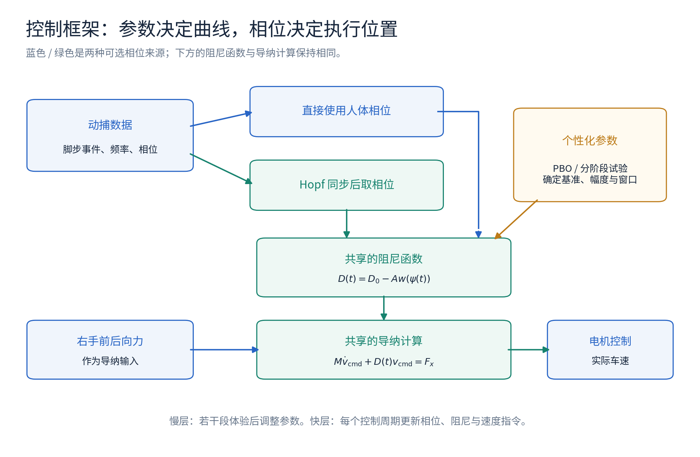
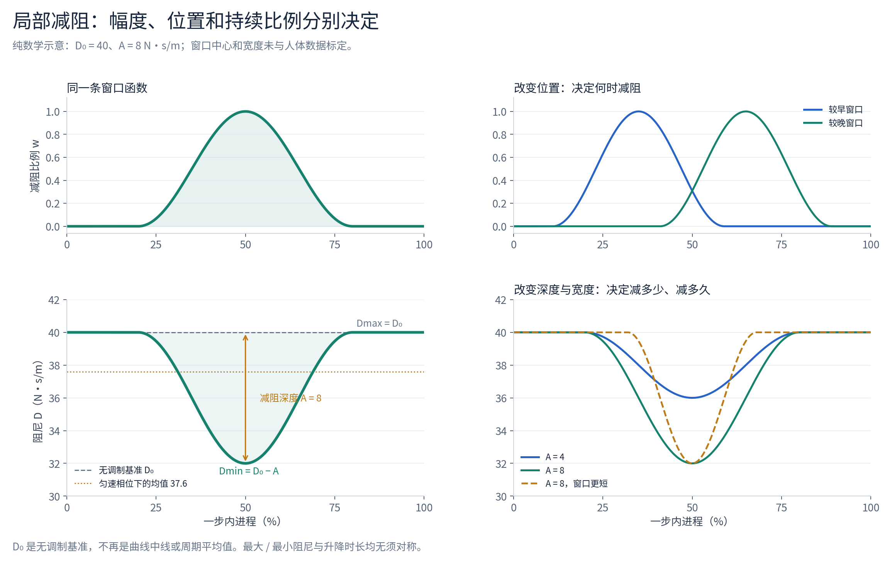
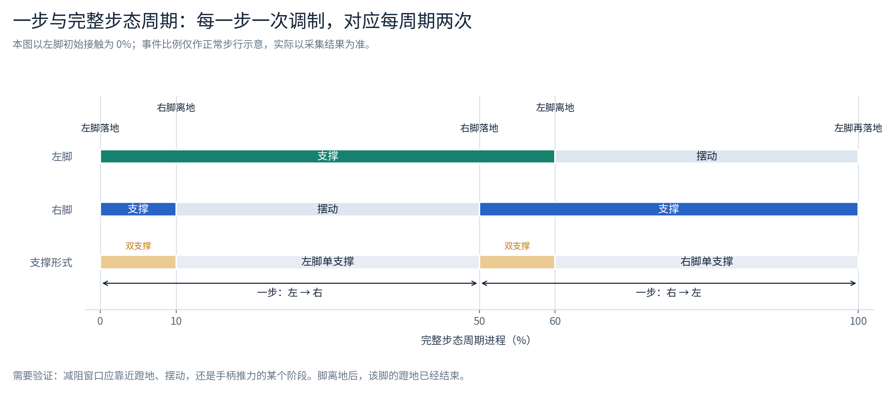
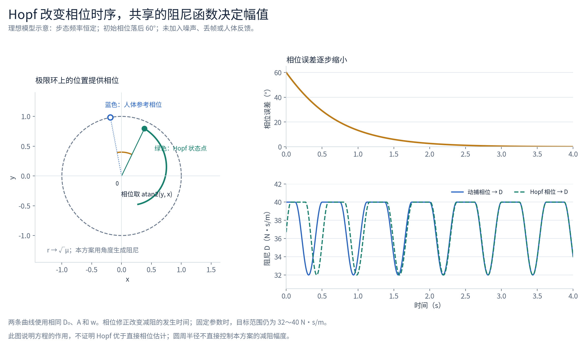
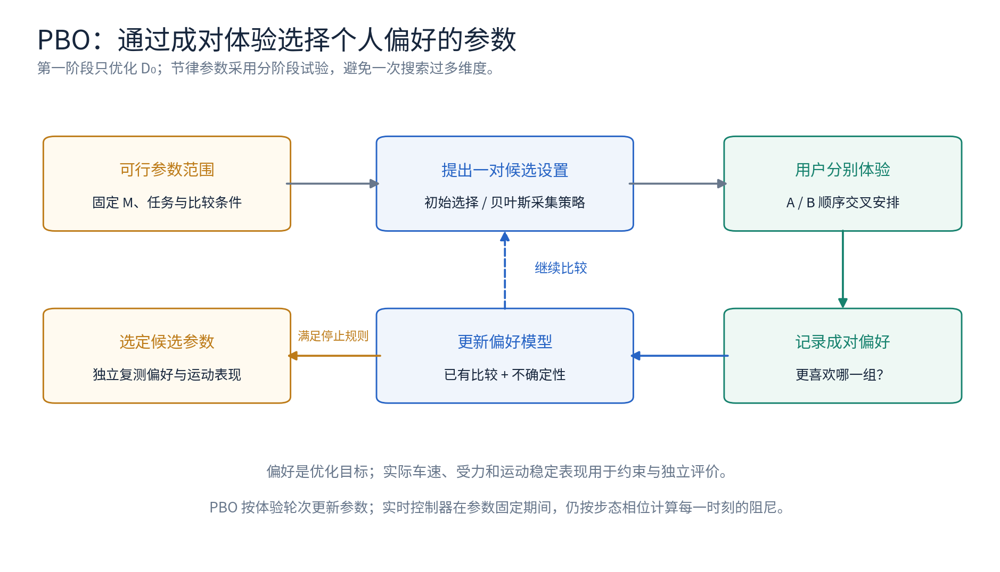
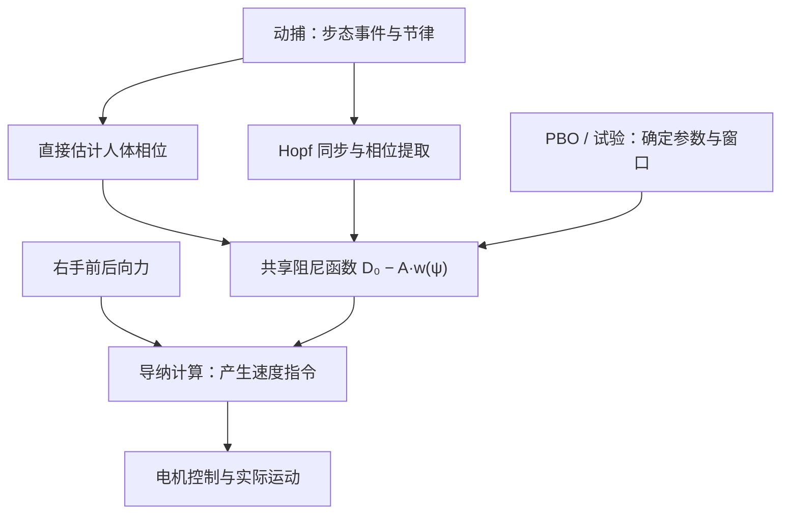
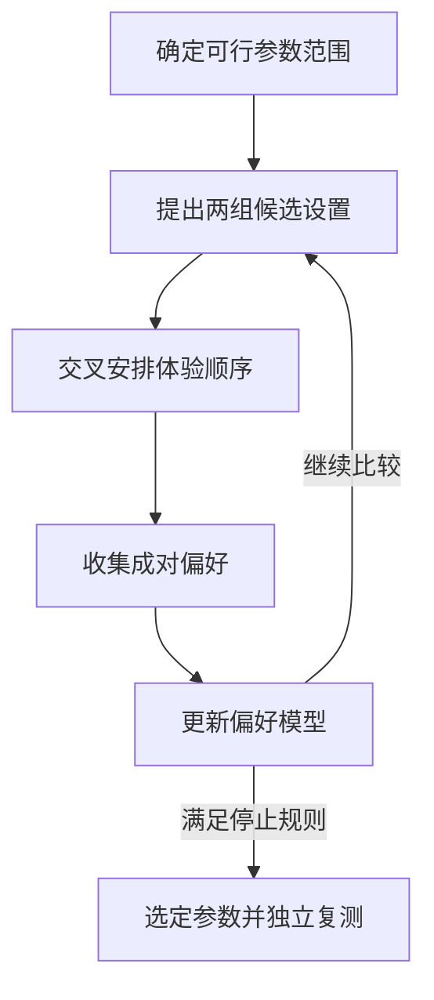

# 智能助行车：个性化步态变导纳控制思路

导师讨论稿 · 2026 年 10 月 16 日

本文整理当前的研究想法，供方案讨论与实验设计使用。PBO 已确认为 **Preferential Bayesian Optimization，偏好贝叶斯优化**。文中的控制律、参数范围和实验安排仍需结合整车验证；所有配图均为结构或数学示意，未使用实验结果。

**我们的目标是让助行车更适合人的行走方式，兼顾推行用力、跟随效果、运动平稳和支撑需求。**

目前拟从三个方面推进：根据个人偏好确定基础推行感；根据步态阶段安排阻尼变化；比较直接使用动捕相位与人体同步 Hopf 的效果。节律同步是整个研究中的一个组成部分，其价值最终体现在人车交互表现上。

本次希望与老师讨论的核心问题是：个人基准阻尼如何确定；减阻应该发生在一步的哪个阶段；减阻幅度与持续时间如何选择；加入 Hopf 后是否获得足以支持其使用的收益。

**我们先用导纳控制建立手柄力与车速指令之间的关系。**

初期只考虑车的前后运动，使用虚拟质量—阻尼模型：

$$
M\dot v_{\mathrm{cmd}}+D\,v_{\mathrm{cmd}}=F_x .
$$

| 符号 | 含义 | 单位或说明 |
|---|---|---|
| $F_x$ | 经过处理的右手前后向力输入 | N；需要统一方向与零点 |
| $v_{\mathrm{cmd}}$ | 导纳计算得到的车速指令 | m/s；与实际车速分开记录 |
| $M$ | 虚拟质量 | kg；第一阶段固定 |
| $D$ | 虚拟阻尼 | N·s/m；本阶段重点研究的参数 |

导纳控制器根据交互力生成运动参考，底层电机控制再跟踪该参考。实际呈现给人的动态还受到滤波、运动控制带宽和机构等因素影响。[1]

将方程改写为

$$
\dot v_{\mathrm{cmd}}=\frac{F_x-Dv_{\mathrm{cmd}}}{M},
$$

可以看到控制器每次根据当前力和速度计算速度变化。接近匀速、惯性项较小时，有 $F_x\approx Dv_{\mathrm{cmd}}$。这说明，在该模型中，降低阻尼可以减小维持相同速度所需的推力。起步和变速时，虚拟质量也会影响推行感。

这里的 $M$ 和 $D$ 是软件中的虚拟参数。右手前后向力也不等于人体全部推进力，更不能单独代表人体竖直承重或平衡状态。

**恒定导纳提供一个可用的个人基准，变导纳进一步调整一步内的响应。**

恒定导纳使用 $D=D_0$。对同一个人，控制器在蹬地、摆动和落脚阶段都采用相同的力—运动关系。我们先调好这套基准，再研究节律调制是否带来额外收益。

当前拟保持 $M$ 不变，让阻尼随时间变化：

$$
M\dot v_{\mathrm{cmd}}+D(t)v_{\mathrm{cmd}}=F_x(t).
$$

变导纳可以根据受力、速度或运动状态调整参数。本文选择其中一个方向：根据步态相位调整阻尼。人的手柄力继续影响车的运动，步态信息参与决定当前采用多大的阻尼。

初步假设是：在适合的阶段降低阻尼，可能让车更容易随人前进；其他阶段维持或恢复合适的阻尼。该假设需要通过实验与恒定阻尼比较。

*图 1. 蓝色和绿色表示两种可选的相位路径。个性化参数决定阻尼曲线的形状与范围，相位决定当前读取曲线的位置，手柄力和当前阻尼共同进入导纳计算。*

**当前优先讨论“基准阻尼上叠加局部减阻”的控制律。**

$$
\boxed{D(t)=D_0-A\,w\bigl(\psi(t)\bigr)},\qquad 0\leq w(\psi)\leq1 .
$$

| 参数或函数 | 作用 | 初期如何确定 |
|---|---|---|
| $D_0$ | 无节律调制时的基础阻尼 | 用 PBO 寻找个人偏好的设置 |
| $A$ | 从基础阻尼最多降低多少 | 先小幅试验，再比较不同幅度 |
| $w(\psi)$ | 减阻窗口，定义开始、最低点及恢复过程 | 先选少参数的平滑函数 |
| $\psi(t)$ | 一步内的当前相位 | 直接动捕估计，或由同步后的 Hopf 提供 |

当 $w=0$ 时，阻尼等于 $D_0$；当 $w=1$ 时，阻尼等于 $D_0-A$。第一版由此得到：

$$
D_{\max}=D_0,\qquad D_{\min}=D_0-A>0,\qquad 0\leq A<D_0 .
$$

此前对称余弦方案中的 $\Delta D$ 是围绕中线的变化幅度。此处用 $A$ 表示单向减阻深度，避免混淆：在当前单向减阻方案中，$A$ 也等于最大、最小阻尼之差。$D_0$ 表示无调制基准，不再等于周期平均阻尼。

最大值、最小值不需要围绕 $D_0$ 对称。如果实验显示某阶段需要高于基础阻尼的设置，可以独立引入上调量 $B$，使 $D_{\min}=D_0-A$、$D_{\max}=D_0+B$。$A$ 与 $B$、下降时间与恢复时间均可独立设置；初期先研究单向减阻，控制参数数量。

*图 2. 示意参数为 $D_0=40$、$A=8$ N·s/m，阻尼范围为 32～40 N·s/m。这些数值不构成实车参数建议。相同的上下限可以对应不同的窗口位置和持续时间。图示相位匀速推进时，平均阻尼为 37.6 N·s/m。*

为了使后续实现可复现，可以先使用一个带平滑边缘的余弦窗口。设 $\psi_c$ 为窗口中心、$h$ 为半宽度：

$$
d=\operatorname{atan2}\!\left(\sin(\psi-\psi_c),\cos(\psi-\psi_c)\right),
$$

$$
w(\psi;\psi_c,h)=
\begin{cases}
\dfrac{1+\cos(\pi d/h)}{2}, & |d|\leq h,\\
0, & |d|>h,
\end{cases}
\qquad 0<h<\pi .
$$

这个函数在窗口边缘回到零，且斜率为零。窗口覆盖一步的相位比例为 $h/\pi$。它是便于比较的初始函数；若数据表明下降、保持与恢复过程需要不同持续时间，再扩展为分段平滑函数。

**相位负责安排执行时机，频率决定相位推进的快慢。**

本文区分两个周期：

| 概念 | 事件定义 | 对当前调制设想的意义 |
|---|---|---|
| 一步 | 一侧脚初始接触到对侧脚初始接触 | 希望完成一次减阻与恢复 |
| 完整步态周期 | 同一侧脚初始接触到该脚下一次初始接触 | 通常包含左右两步、两次阻尼调制 |

将一步内的进程写成相位 $\psi\in[0,2\pi)$。频率告诉我们这一步进行得多快，相位告诉我们现在处于哪里。单有步频，还不足以安排减阻时机。

为与此前 Hopf 演示衔接，记完整步态相位为 $\phi$。左右近似对称、相位按同一约定定义时，可以使用

$$
\psi=(2\phi)\bmod 2\pi .
$$

若完整步态频率为 $f_{\mathrm{stride}}$ Hz，则对应步频约为 $120f_{\mathrm{stride}}$ 步/分钟。该换算不能把不对称步态强行变成两个等长的半周期；遇到明显左右差异，应分别利用左右脚事件估计每一步的进程，并考虑两侧不同的窗口。

*图 3. 本图用左脚初始接触作为周期起点。事件百分比只用于说明两步和支撑阶段的关系，实验中需要根据真实事件重新标定，不能照搬固定比例。*

**减阻窗口应该放在哪里，需要用人体和手柄数据共同判断。**

目前的直觉方案是：双脚落地时维持较高阻尼，迈步过程中降低阻尼，下一只脚落地附近再恢复。这可以作为一个候选方案，但需要分清“蹬地推进”和“离地后摆动”。

正常步行研究表明，后腿的推进做功可以在双支撑开始前出现，并持续到该脚离地；前腿落地吸收能量与后腿推进存在时间重叠。[4] 因此，若希望对齐蹬地，减阻可能要在脚离地前开始；若希望在摆动阶段更容易推车，则是另一种窗口位置。

| 候选窗口 | 研究假设 | 需要观察的数据 |
|---|---|---|
| 靠近后腿蹬地 | 降低人体推进阶段的推行负担 | 脚步事件、身体运动与手柄力的关系 |
| 覆盖摆动阶段 | 使车更容易随身体前移 | 前后向手柄力、实际速度及人车相对运动 |
| 对齐手柄前向推力特征 | 在人明显推车的阶段减阻 | 相位对齐后的手柄力波形与控制延迟 |

仅凭动捕可以定位运动事件，不能直接确认足底推进力的大小。仅凭右手力峰值，也不能确认最佳减阻相位。推力峰值附近可以作为候选位置，再比较提前、对齐与滞后的效果。

落脚时提高阻尼是否改善支撑，同样需要验证。在简化模型中，持续非零推力和有限阻尼仍可能产生 $v_{\mathrm{cmd}}=F_x/D$ 的运动。前后向高阻尼与车轮保持、竖直承重属于不同问题。实验需要记录增阻后的减速和人车相对运动，避免用“阻尼更大”直接推断“更安全”。

**动捕直接方案和 Hopf 方案共用同一条阻尼曲线，只更换相位来源。**

动捕直接方案先根据脚的位置与接触事件估计人体相位，再计算：

$$
D_{\mathrm{direct}}(t)=D_0-Aw\bigl(\psi_g(t)\bigr).
$$

“直接”包含必要的信号处理、事件检测和相位估计。检测落地事件后可校正相位，事件之间依据近期节律预测进程；估计器的滤波、延迟和修正方式需要明确记录。

Hopf 方案先用人体节律同步内部振荡器，再用振荡器相位计算：

$$
D_{\mathrm{Hopf}}(t)=D_0-Aw\bigl(\psi_H(t)\bigr).
$$

当前讨论的是一种相位耦合的 Hopf 形式。以完整步态相位 $\phi$ 为例：

$$
\Omega=\hat\omega_g+k_\phi\sin(\phi_g-\phi_H),
$$

$$
\begin{aligned}
\dot x&=\alpha(\mu-x^2-y^2)x-\Omega y,\\
\dot y&=\alpha(\mu-x^2-y^2)y+\Omega x,\\
\phi_H&=\operatorname{atan2}(y,x).
\end{aligned}
$$

这里 $\hat\omega_g$ 为完整步态的估计角频率，$k_\phi$ 决定相位纠正强度。对 $\alpha>0$、$\mu>0$ 和非零初始半径，可得到

$$
\dot r=\alpha(\mu-r^2)r,\qquad
\dot\phi_H=\hat\omega_g+k_\phi\sin(\phi_g-\phi_H).
$$

半径趋向 $\sqrt{\mu}$，角度随人体节律推进。初期不再用原始手柄力额外驱动振荡器，保留明确的人体相位耦合；手柄力继续作为导纳输入。

| 模块或参数 | 在当前方案中的作用 |
|---|---|
| $\hat\omega_g$、$k_\phi$ | 决定相位推进和纠正过程 |
| $\alpha$、$\mu$ | 决定径向收敛和极限环半径 |
| $\phi_H$、$\psi_H$ | 提供读取阻尼函数的位置 |
| $D_0$、$A$、$w$ | 决定阻尼水平、变化范围与窗口形状 |

当前只使用振荡器相位，因此改变极限环半径不会直接改变阻尼幅度。相位修正可能使阻尼曲线在时间上局部压缩或拉长；固定 $D_0$、$A$ 和 $w$ 时，目标阻尼范围保持不变。

*图 4. 理想相位耦合模型中的示意结果。输入完整步态频率为 0.8 Hz，初始相位落后 60°，$k_\phi=1.6$ rad/s；径向参数为 $\alpha=3$、$\mu=1$、$r(0)=0.55$，左图显示 0.35 s 时的状态。两条阻尼曲线使用相同的窗口。图中没有噪声、丢帧或人体反馈，不用于证明 Hopf 的实用优势。*

这类相位耦合形式在极坐标下可以直接实现为相位微分方程。因此，Hopf 的径向动力学是否必要、它相对简单相位估计或相位同步器是否有增益，也是需要讨论的问题。短时预测并非 Hopf 独有，直接方案也可以采用预测和滤波。比较时应说明两个方案各自的估计器与延迟。

**PBO 用于寻找个人偏好的参数，实时控制器按当前参数持续运行。**

PBO 根据用户对两组设置的偏好建立模型，再选择下一组值得比较的参数。它可以在难以直接量化舒适感时，利用成对比较寻找偏好的设置。[2] 已有研究将这一方法用于导纳参数调整，并在机械臂人机协作中验证；这些结果为方法选择提供依据，助行车的效果仍需自行验证。[3]

在本项目中，可将个人偏好写为未知函数 $u_p(\theta)$，在已验证可用的参数集合 $\Theta_{\mathrm{feasible}}$ 中寻找偏好较高的设置：

$$
\theta_p^*\approx
\underset{\theta\in\Theta_{\mathrm{feasible}}}{\operatorname{argmax}}
\ u_p(\theta).
$$

我们不要求用户给出 $u_p$ 的数值，而是收集两种设置的比较结果。贝叶斯模型表达当前对偏好的估计及不确定性，采集策略决定后续比较。具体模型、是否允许“难以区分”、停止规则和重复次数需要在实验方案中确定。

初期将参数写成 $\theta=[D_0]$，固定虚拟质量、行走任务和其他控制设置，让用户比较基础推行感。取得候选 $D_0$ 后，先固定基准，再研究窗口位置、幅度与宽度。后续若需要联合优化，可扩展到 $\theta=[D_0,A,\psi_c,h]$，但不建议第一轮同时搜索全部参数。

*图 5. PBO 在若干段体验后更新参数，步态相位则在行走过程中实时更新阻尼。选定参数后，使用独立试次检查偏好是否可重复，以及客观运动表现是否可接受。*

个人偏好不一定保持不变，使用经验和行走条件都可能影响选择。外骨骼研究已经观察到这类变化，[5] 因而当前得到的结果应表述为“这个人在当前条件下偏好的参数”。PBO 的目标是偏好，最低能耗、支撑效果与安全性需要另外评价。

**实验需要分别辨认个性化、减阻时机和相位来源的贡献。**

拟采用以下分阶段路线：

1. 建立稳定可用的恒定导纳控制，明确力与速度的单位、方向、滤波和时间戳。
2. 在固定参数下同步记录脚步事件、右手前后向力、速度指令和实际车速，观察相位对齐后的平均波形与步间差异。
3. 用 PBO 确定个人基准阻尼 $D_0$，再通过独立试次检查偏好重复性。
4. 固定 $D_0$，用小幅调制比较窗口位置；之后比较幅度和持续时间。
5. 使用相同的 $D_0$、$A$、窗口和下游处理，比较直接动捕相位与同步 Hopf。

| 对照条件 | 主要回答的问题 |
|---|---|
| 个人基准恒定阻尼 $D_0$ | 节律方案是否比可用的个人基准更合适 |
| 平均阻尼接近的恒定设置 | 改善是否主要来自整体阻尼降低 |
| 固定频率 / 非同步的周期调制，作为可选对照 | 与人体节律对齐是否提供额外收益 |
| 动捕相位调制 | 直接利用人体相位可以达到什么效果 |
| 人体同步 Hopf 调制 | 内部振荡器相对直接相位方案是否有增益 |

单向减阻会降低平均阻尼。为了辨认“减阻时机”的贡献，应设置平均阻尼接近的恒定对照。匹配时使用实际时间平均

$$
\bar D=\frac{1}{T}\int_0^T D(t)\,dt,
$$

不能只取最大值与最小值的算术平均。实验前明确匹配方法，并报告匹配误差。该对照能控制平均阻尼的差异，但不能代替对全部动态效应的分析。

比较试次应尽量匹配路线、速度区间、地面与其他控制设置，交叉安排条件顺序，并区分调参数据与最终评价数据。PBO 得到基础设置后，加入节律可能改变偏好；第一轮先固定基准以解释节律效应，必要时再做联合复调。

| 评价内容 | 拟记录指标 | 解释范围 |
|---|---|---|
| 推行用力 | 右手前后向力 RMS、前向与反向峰值 | 反映所测手柄交互，不能直接代表全身能耗 |
| 运动平稳 | 实际车速、加速度波动、异常减速 | 需要与速度和任务条件一起解释 |
| 节律跟随 | 相位误差、步频改变后的恢复过程 | 分开报告完整步态相位和一步相位 |
| 用户体验 | 成对偏好、费力感、跟随感与支撑感 | 主观支撑感不等于客观安全证明 |
| 支撑相关表现 | 人车相对距离、载荷与稳定性指标 | 根据现有传感能力决定是否需补充测量 |

如果某个时机或幅度没有收益，保留恒定阻尼或缩小调制幅度是合理结果。当前不预设 Hopf 或周期调制必然优于对照。

**工程上先实现一个可记录、可比较的最小方案。**

动捕端处理脚步事件和节律估计；实时控制端选择相位来源，计算目标阻尼，再执行导纳积分和速度控制。所有信号应使用可对齐的时间戳。相位对齐后的人体事件时刻，不应与收到数据的时刻混为一谈。

建议先保持 $D_0$、$A$ 和窗口参数在一段试次内不变，并记录目标阻尼与实际使用的阻尼。若实现中加入限幅、变化率限制或平滑，两种相位方案应采用相同设置；这些处理也可能改变幅度和时机，应在分析中说明。

持续丢失步态数据、停止行走或明显异常时，应切换到预先验证的非周期策略。行走减阻、制动保持与承重需求应分别设计和评价。

**本次与老师讨论，希望形成以下决策。**

| 讨论问题 | 当前建议 | 需要老师共同确定的内容 |
|---|---|---|
| 研究范围 | 第一阶段固定 $M$、研究前后向变阻尼 | 是否接受该范围，如何定义主要收益 |
| 个性化参数 | 先用 PBO 优化 $D_0$ | 偏好提问方式、可行范围、试次和停止规则 |
| 周期定义 | 以每一步一次调制为候选 | 是否根据实际右手力波形调整，是否区分左右步 |
| 减阻时机 | 比较少数明确的候选窗口 | 首先研究蹬地、摆动还是手柄力特征 |
| 阻尼形状 | 基准上叠加局部减阻，平滑恢复 | 是否有证据需要高于基准的阻尼阶段 |
| Hopf 的角色 | 保留为待比较的相位方案 | 与直接估计 / 简单相位同步器如何公平比较 |
| 支撑评价 | 将主观感受与客观运动表现分开 | 现有传感器是否足够，需要补充什么 |
| 实验判据 | 偏好、手柄受力与运动平稳共同评价 | 主指标、可接受范围及实验对象 |

**讨论所依据的文献如下。**

1. Keemink, A. Q. L., van der Kooij, H., & Stienen, A. H. A. (2018). *Admittance control for physical human–robot interaction*. The International Journal of Robotics Research, 37(11), 1421–1444. [DOI: 10.1177/0278364918768950](https://doi.org/10.1177/0278364918768950)。用于导纳控制框架与实际动态影响的依据。
2. González, J., Dai, Z., Damianou, A., & Lawrence, N. D. (2017). *Preferential Bayesian Optimization*. ICML / PMLR 70, 1282–1291. [论文页面](https://proceedings.mlr.press/v70/gonzalez17a.html)。用于 PBO 的成对偏好与贝叶斯选择框架。
3. Tran, L. D., Yamawaki, T., & Yashima, M. (2025). *Mixed reality-enhanced spatial admittance control for human-robot collaboration using preferential Bayesian optimization*. Mechanical Engineering Journal, 12(1), 24-00305. [DOI: 10.1299/mej.24-00305](https://doi.org/10.1299/mej.24-00305)。提供 PBO 调整导纳参数的研究实例，实验对象为机械臂。
4. Adamczyk, P. G., & Kuo, A. D. (2009). *Redirection of center-of-mass velocity during the step-to-step transition of human walking*. Journal of Experimental Biology, 212, 2668–2678. [DOI: 10.1242/jeb.027581](https://doi.org/10.1242/jeb.027581)。用于蹬地、落地与步间转换时序的依据，不直接规定助行车阻尼策略。
5. Ingraham, K. A., Remy, C. D., & Rouse, E. J. (2022). *The role of user preference in the customized control of robotic exoskeletons*. Science Robotics, 7(64), eabj3487. [DOI: 10.1126/scirobotics.abj3487](https://doi.org/10.1126/scirobotics.abj3487)。用于个体偏好与条件依赖性的参考，不能直接外推为助行车结论。

配图由本文所列方程或概念关系绘制。PNG 供阅读，SVG 供放大和后续排版；配图与本文一同保存在文件包中。

可编辑的流程图源代码（Mermaid）

控制框架：两种相位来源共用阻尼计算与导纳控制。

PBO：参数按体验轮次更新，选定后独立复测。

