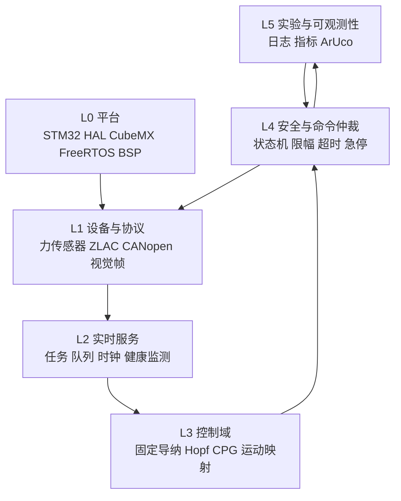

# SmartRollator 系统架构

## 总体原则

架构采用单向分层：上层可以依赖下层公开接口，下层不得引用上层业务对象。算法与硬件解耦，所有执行器输出汇聚到安全仲裁层。



## 分层职责

### L0 平台层

负责时钟、GPIO、DMA、UART、FDCAN、定时器、FreeRTOS 和板级资源。CubeMX `.ioc` 是配置事实源；生成代码只做平台初始化和适配。

### L1 设备与协议层

- RS485 力传感器：收发、帧同步、校验、缩放、错误计数。
- ZLAC8015D/CANopen：节点控制、PDO/SDO、速度命令、状态和故障解析。
- USART1/视觉：定义清晰的输入帧和有效期，不直接影响电机输出。

### L2 实时服务层

定义任务周期、优先级、队列、时间戳、健康心跳和背压策略。它负责调度数据，不承载控制数学或协议字节解析。

### L3 控制域

纯 C 模块：输入为带单位的有效数据和参数，输出为目标线速度/角速度或左右轮期望值。固定导纳是基线；Hopf CPG 是可替换策略，不侵入平台代码。

### L4 安全与命令仲裁

唯一的执行器命令出口。负责使能条件、模式切换、方向一致性、饱和、斜率限制、看门狗、急停和故障降级。任何算法都不能绕过该层。

### L5 实验与可观测性

记录关键输入、状态、输出、延迟、丢帧、故障和算法指标。日志通道拥塞时允许丢低优先级日志，但不得阻塞控制环。

## 主数据流

```text
力传感器原始帧
  → 校验/标定后的 ForceSample
  → 实时快照或队列
  → 控制策略 FixedAdmittance / HopfCPG
  → MotionIntent
  → SafetyArbiter
  → WheelCommand
  → CANopen/ZLAC8015D
  → DriverStatus 与故障反馈
```

## 核心数据契约

- `ForceSample`：时间戳、Fx/Fy/Fz（N）、有效标志、质量/错误码。
- `MotionIntent`：时间戳、线速度（m/s）、角速度（rad/s）、来源模式、有效标志。
- `WheelCommand`：左右轮速度、使能位、限幅原因、序号。
- `DriverStatus`：节点状态、实际速度、总线状态、错误码、最后更新时间。
- `SystemHealth`：任务心跳、输入新鲜度、故障位、当前安全状态。

具体字段在首次实现前由 `LAYER_CONTRACT.md` 冻结；本文件只定义跨层语义。

## 时间与并发

- 使用单调时钟表达周期和超时，不用日志时间推断实时性。
- 控制周期和各任务预算在 `TEST_METRICS.md` 中建立并通过测量冻结。
- ISR 只完成最短的收发与通知；解析、控制和日志在任务上下文执行。
- 单生产者/单消费者优先使用队列或双缓冲快照；多写共享状态必须显式同步。

## 安全状态

建议状态机：`BOOT → SELF_TEST → READY → ENABLED → DEGRADED/FAULT → SAFE_STOP`。实际转换条件在安全层阶段实现和测试前冻结，所有异常路径最终可达无驱动力状态。
